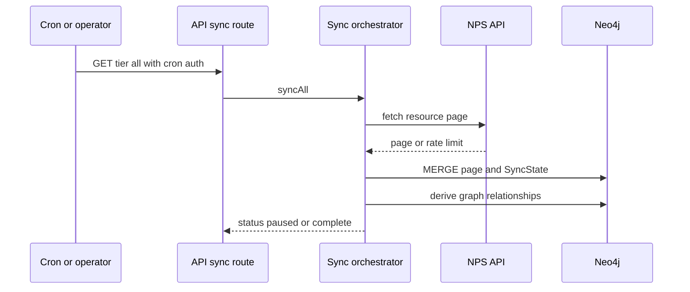

# Neo4j schema and data lifecycle

`lib/neo4j.ts` is the application graph boundary: `readGraph()` uses `executeRead`, `writeGraph()` uses `executeWrite`, and `sanitizeParams()` turns `undefined` into `null` and serializes Dates. The selected database is `NEO4J_DATABASE` (default `neo4j`). Application code owns domain/app writes; NAMS owns its context-memory writes, but both target the same Neo4j database.

## Schema and migration contract

`pnpm db:migrate` runs lexical `db/migrations/*.cypher` through `db/migrate.ts`. Migrations must be idempotent: there is no migration-history ledger. `001_constraints_indexes.cypher` establishes natural keys (for example `Park.parkCode`, `User.userId`, `Trip.id`), point/full-text/vector indexes; later migrations add operating data, school, analytics, trails, campground federation, camp context, home and planner transcript. `db/verify.ts` is the narrow post-migration check.

Key model families:

- **Domain:** Park, State, Activity, Topic, Place, Person, Tour, Alert/Event/NewsRelease, fees, parking, schedules and accessibility.
- **Personal/app:** User, Trip, Stop, ShareLink, watches/digests, transcripts and preference bridges.
- **Trails/camps:** Trail/Campground/Campsite and query relationships; geometry pointers point outside Neo4j.
- **Learning:** `LessonPlan → Module → Lesson → QuizQuestion`, grade bands, progress, badges and certificates.

## Sync lifecycle

The route invokes slow then fast work for `tier=all`; no tier returns `syncStatus()` instead of mutating. `assertCron` protects it. A page is upserted before the next page request, so a rate limit can safely pause and resume.

`lib/sync/index.ts` divides the corpus into slow (vocabulary, parks, local NPS resources, fees, articles, lesson plans and optional heavy enrichments) and fast (alerts, events, news). `step()` persists `SyncState`, skips fresh successes unless `SYNC_FORCE=1`, pauses typed rate-limit errors, and retries other failures before workflow retry. `pagedStep()` and `pagedExternalStep()` persist cursors/counts for large NPS/RIDB feeds; MERGE makes replay safe. Freshness windows are 20 hours for slow/all and 90 minutes for fast.

`lib/nps.ts` pages at 50, retries 429/5xx/malformed JSON with backoff, and throws `NpsRateLimitError` after exhaustion. Focused proof: `lib/nps.test.ts`; sync parsing/upsert behavior: `lib/sync/upserts.test.ts`, `tests/integration/nps-expansion.itest.ts`, `tests/integration/nps-data-features.itest.ts`.

## Source split and derived graph

| Store/source | Responsibility |
|---|---|
| Neo4j | indexed metadata, canonical entities, relationships, SyncState, app state and derived links |
| Vercel Blob; `public/trails/` only locally | per-park trail FeatureCollections/profiles and campground site geometry |
| NPS | core corpus and live webcams/road events |
| RIDB/Recreation.gov | multi-agency facilities/sites and advisory availability |
| Open-Meteo, ORS, elevation | runtime weather, route matrix, optional elevation |

`sync-trails.ts` requires both matching content hash **and** `Park.trailsGeoUrl` to skip; absent Blob pointer forces re-upload. Elevation samples each MultiLineString segment separately and stops on 429 rather than marking a partial trail. `deriveNear()` rebuilds asymmetric nearest links (default 150 miles/top 10); shared topic/activity, trail logistics/network, lessons, co-consideration and analytics are post-ingest derivations. See [trails](../systems/trails-and-journeys.md) and [map assets](../systems/map-and-graph.md).

## Safe changes

1. Add idempotent Cypher with a natural key/index when a new durable model needs one; run `pnpm db:migrate && pnpm db:verify` on an isolated database.
2. Add/alter a resource in `lib/sync/index.ts` and `lib/sync/upserts.ts`; retain raw NPS nested data when later parsers need it. Define stale-removal semantics explicitly—hours recreate prior nodes, alerts/events soft-expire, and entrance fees rebuild globally.
3. Put optional expensive/external work behind the existing flags (`SYNC_TRAILS`, `EMBED_TRAILS`, `EMBED_ARTICLES`, `DECOMPOSE_LESSONPLANS`, etc.), with null/unknown read behavior.
4. Cover pure transform/derivation tests and guarded real-Neo4j integration tests before expanding public query surfaces.