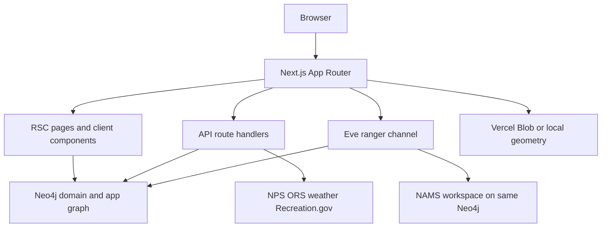

# TrailGraph architecture

TrailGraph is a Next.js App Router application for U.S. park discovery and trip planning. Its defining design is **one Neo4j database**: application-owned NPS/domain and user data coexist with NAMS-owned agent memory, allowing a user preference bridge to traverse directly to park facts. Next serves RSC pages, API route handlers, and—unless disabled—the Eve ranger service via `withEve(nextConfig)` in `next.config.ts`.

This is the runtime ownership map; NAMS is accessed only through the application memory gateway while normal domain/app writes use the Neo4j boundary.

## Ownership and entrypoints

| Concern | Owner and entrypoint | Canonical detail |
|---|---|---|
| Browser product | `app/` pages, `components/`, Chakra `theme/` | [Discovery](../systems/discovery.md), [Map and graph](../systems/map-and-graph.md) |
| Agent | `agent/agent.ts`, `agent/channels/eve.ts`, `agent/tools/` | [Ranger and memory](../systems/ranger-memory.md) |
| Graph/database | `lib/neo4j.ts`, `db/migrations/`, `lib/queries.ts` | [Data platform](data-platform.md) |
| NPS and enrichment ingest | `app/api/sync/route.ts`, `lib/sync/index.ts`, `lib/datasources/` | [Data platform](data-platform.md) |
| Personal itinerary | `components/plan/PlanShell.tsx`, `lib/trips.ts`, `/api/trips` | [Trip planning](../systems/trip-planning.md) |
| Large geometry/assets | `lib/blob-trails.ts`, `lib/blob-campsites.ts`, PMTiles tooling | [Map and graph](../systems/map-and-graph.md) |
| Jobs, deploy, security, checks | `vercel.json`, `next.config.ts`, test configs | [Operations and testing](../operations-and-testing.md) |

## Principal runtime flows

### Request and identity

Better Auth receives its handler at `app/api/auth/[...all]/route.ts`. `lib/auth.ts` pins trusted origin and uses magic-link delivery in production; `E2E_TEST_MODE` enables deterministic password authentication and its test-oriented behavior. The Neo4j adapter in `lib/better-auth-neo4j-adapter.ts` maps Better Auth models to labels, implements create/find/list/count/update/delete CRUD against those labels, projects plain properties, translates declared predicates (including dates), and advertises its date/JSON capabilities. Its user create path mirrors auth `user.id` to application `User.userId`, the anchor of all graph ownership. Changing an auth field, predicate/property projection, or deletion behavior therefore requires migration/adapter review: deleting a User changes the root reachable by every personal workflow. Page/API code uses `lib/session.ts`; the Eve channel uses `lib/eve-auth.ts` to derive `principalId`. Agent tools call `callerId(ctx)` from `lib/agent-ctx.ts`, so a model never supplies a user ID. Validate this live adapter contract with `tests/integration/auth-adapter.itest.ts` (plain properties, ID mirroring, date filters and deletion).

### Data to experience

`/api/sync?tier=all` fetches NPS resources, performs idempotent graph upserts, then derives query relationships. RSC discovery pages consume `lib/queries.ts`; client-heavy map/graph UI consumes bounded read APIs. Trails keep filterable metadata/topology in Neo4j but store large FeatureCollections in Blob. Runtime weather/webcam/road adapters are intentionally not persisted. See [data lifecycle and schema](data-platform.md).

### Planning and memory

A planner mutation validates request data, checks `Trip.userId`, writes a reified `Stop`, and recomputes route summaries. The ranger receives server-bound identity, injects deterministic graph memory at turn start, and asynchronously persists conversational/reasoning events to NAMS. Explicit preferences dual-write raw NAMS facts and canonical Neo4j bridges, making them immediately usable by recommendation and UI. See [trip planning](../systems/trip-planning.md) and [ranger memory](../systems/ranger-memory.md).

## Architectural boundaries

- **Do not put raw client user IDs in agent-tool inputs.** Identity is derived from session state.
- **Neo4j is the queryable source for entities, relationships, personal data and sync state.** Blob holds heavyweight geometry; external providers hold live/advisory data.
- **Read surfaces degrade rather than invent facts.** Missing geometry, embeddings, weather, availability, or optional enrichment results in an explicit fallback/unknown state.
- **Public expensive endpoints are bounded and rate limited.** Graph labels/lenses and map state are allowlisted; capability share links are read-only.

Use [operations](../operations-and-testing.md) before changing composition, environment/configuration, or scheduled behavior.