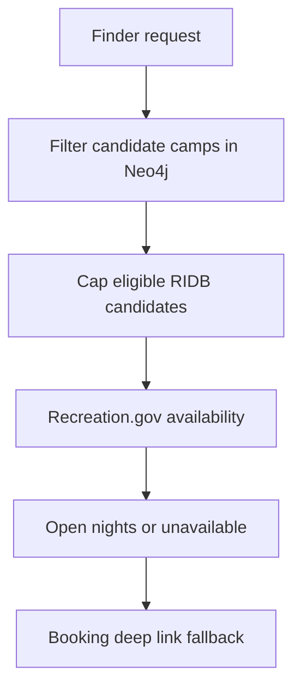

# Campgrounds, availability, and watches

The campground product is server-rendered finder/detail/compare at `app/campgrounds/`, backed by `lib/campgrounds.ts`. It combines NPS records with optional RIDB multi-agency import: matching Recreation.gov IDs unify in place rather than creating separate facilities. Campground/campsite metadata is Neo4j; large site/loop geometry is an optional Blob pointer (`Campground.sitesGeoUrl`) via `lib/blob-campsites.ts`.

## Discovery and booking semantics

Search supports text, agency, reservable/FCFS/free/dispersed, site/hookup/RV/ADA/pet/water/shower/dump/cell features, price/elevation, dark sky, park/trail/bbox proximity and availability eligibility. “Near park” includes both `IN_PARK` and `NEAR`, intentionally allowing cross-agency locations. IDs are encoded in cards and decoded by detail/API routes because RIDB IDs may contain colons.

`lib/camp-booking.ts` turns source flags/counts into `reservation`, `fcfs`, `mixed`, or `unknown`. Positive counts may infer a mode; zero and missing facts do not. UI has one CTA whose wording follows that result—it must not imply bookability for FCFS/unknown.

## Advisory availability and watches

`/api/campgrounds/availability` is public, IP 30/minute. Live data is enabled only by `CAMP_AVAILABILITY_ENABLED=1`; candidate set is capped at 12, requested range at 60 nights, cache is 15 minutes, and 429/5xx backoff rises from 60 seconds to 30 minutes. Nights are inclusive; `minNights` needs a consecutive run. Disabled/upstream failure yields unavailable/null and a recreation.gov link—not a false zero/open status.

`CampWatch` is a backend/tool system, not currently user-createable in the public page: detail intentionally displays a disabled “soon” affordance. Creation/list/delete are owner-scoped in `lib/camp-watches.ts`, with 10 active watches and expiry for past dates; persisted criteria include dates, night/site constraints, weekend choice, latest snapshot and mute timestamp. `GET /api/camp-watch` cron-authorized polling short-circuits if availability is disabled, expires first, caps 20 camps/watch, skips nonmatching weekend dates and ignores missing RIDB/unavailable provider results rather than asserting closure. The freshness key is `campgroundId|date|siteId`; it diffs current keys with the prior array (null/malformed means no trusted previous opening), so a closing then later reopening is fresh again. It mutes notices 30 minutes, writes digest/inbox and emails only opted-in configured users; inbox/email failures are caught per fan-out and do not abort other watches. Snapshot is always saved after polling, even when muted. It never books a site. Separate `Watch` records drive daily park/trip digests and have a 25 cap.

## Planner and change surface

Planner lodging is nested `Stop-[:STAYS_AT]->Campground`, one relation per stop; adding replaces old lodging. Availability unknown remains eligible in `suggestLodging`, so do not turn an upstream outage into an exclusion. Add a facet through `lib/campgrounds.ts`, GET query/page controls and focused test. Preserve optional geometry fallback: `/api/campgrounds/[id]/sites` returns an empty FeatureCollection rather than failing.

Focused validation: `campgrounds.test.ts`, `camp-booking.test.ts`, `datasources/campAvailability.test.ts`, `camp-watches.test.ts`, `watches.test.ts`; guarded graph tests `campgrounds.itest.ts`, `camp-watches.itest.ts`, `watches.itest.ts`; browser contract `tests/e2e/campgrounds.spec.ts`. See [operations](../operations-and-testing.md) for cron authorization/email failure isolation.