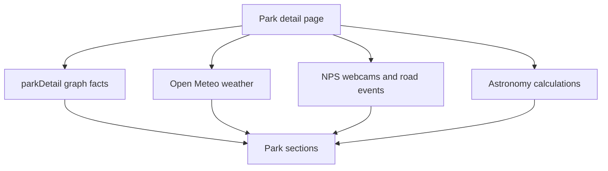

# Explore, search, park detail, and conditions

Normal discovery is server-side Neo4j retrieval, not an agent proxy. `app/explore/page.tsx`, `app/search/page.tsx`, and `app/parks/[parkCode]/page.tsx` use `lib/queries.ts`; Map/agent consumers reuse the same domain reads. The central safety rule is to return absent/unknown data rather than turn sparse or failed sources into a claim.

## Explore and semantic search

`searchParks()` powers the server-rendered GET-form explorer: text, state/activity/topic/amenity/designation/dark-sky and operational facets (fee-free, EV, RV, FCFS, region), pagination and optional home-distance ordering. `toFulltextQuery()` lowercases, strips Lucene metacharacters, tokenizes and prefix-wildcards input. Amenity means a linked Place, VisitorCenter, or Campground has it; an accessible badge means at least one wheelchair-accessible campground, not universal park accessibility. Missing coordinates sort after located parks.

`app/search/page.tsx` embeds text once and reuses it for park/trail/place/person/article vectors; campground lookup remains full-text. `lib/embed-cache.ts` owns reuse. Anonymous requests are limited to 20/minute. Missing embeddings/provider failure produce empty semantic sections, while graph label search remains possible. Article and trail semantic search also require their ingestion flags and embeddings. Constraint-aware candidate filtering is verified by `lib/queries.test.ts`; real query behavior by `tests/integration/explore-search.itest.ts`.

## Park detail and condition provenance

`parkDetail(parkCode)` assembles graph facts with Cypher subqueries to avoid relationship-list Cartesian products: core metadata, taxonomy, active alerts, facilities, fees, schedules, places/articles/people/tours/stamps/parking/news/media, accessibility, related/nearby graph context and lessons. The page starts independent reads in `Promise.all` and catches optional failures. `imagesWithFallback()` prefers rich image objects then safe plain URLs.

The diagram distinguishes persisted facts from runtime adapter outputs. `weather.ts` caches up to 30 minutes and yields null on failure; `conditions.ts` caches webcam/road calls 15 minutes and yields empty arrays. `lib/conditions.ts` uses these facts for trip cards without parsing model prose.

Hours parsing in `lib/sync/hours.ts` and `checkOpen()` has `open | closed | unknown`: absent schedule is unknown; a road closure does not close the whole park if Park Hours says open. Data source sync adds Bortle/visitation/permit/fee-free/accessibility fields; see [data platform](../architecture/data-platform.md).

## Change and validation

Extend a filter by changing the query predicate, facet source and GET parameter together; use relationships rather than duplicated strings. Add a live provider as an isolated adapter with cache and null/empty failure contract, then label it as live/advisory in UI. For facts that need filtering/recommendation, ingest them into graph rather than calling an external provider from every consumer.

Run `lib/queries.test.ts`, `lib/conditions.test.ts`, `lib/sync/hours.test.ts`, provider tests in `lib/datasources/`, then `tests/integration/nps-data-features.itest.ts` and relevant Playwright (`nps-data-features.spec.ts`, `park-charts.spec.ts`) when changing public display.