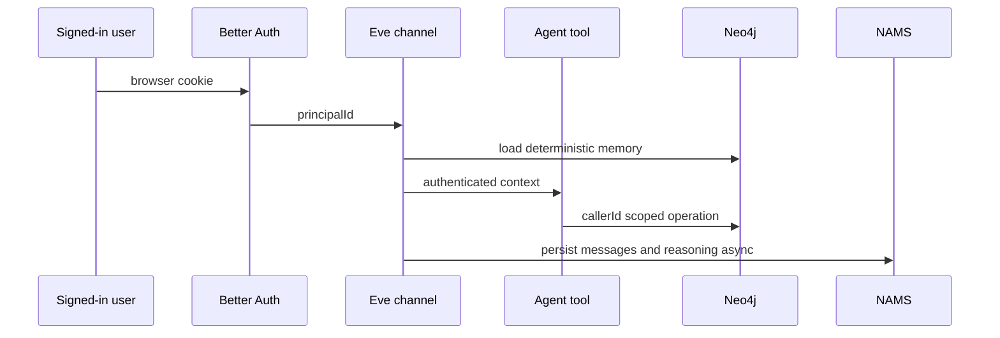

# Ranger agent and context memory

`agent/agent.ts` defines the Eve Ranger with configurable `AGENT_MODEL`, thinking and compaction. `next.config.ts` wraps Next with `withEve`; `DISABLE_EVE=1` intentionally runs the product without the ranger. Agent instructions live in `agent/instructions.md`, `agent/instructions/user-memory.ts`, and tools in `agent/tools/`.

## Identity and turn flow

`agent/channels/eve.ts` admits Better Auth first, then localhost development and Vercel OIDC. It applies a clamp, per-minute and daily usage controls; a null result accepts a request without running/billing a turn. `lib/eve-auth.ts` maps the cookie session to Eve `principalId`. `callerId()` in `lib/agent-ctx.ts` throws without that server-derived principal. Tools therefore must not accept `userId` arguments; REST equivalents derive identity with `lib/session.ts`.

## Memory layers and invariants

| Layer | Owner/path | Role |
|---|---|---|
| Conversation/reasoning | `lib/memory.ts`, NAMS | asynchronous turn persistence and deep recall |
| Canonical context | `lib/memory-graph.ts`, `lib/bridges.ts` | immediate structured preferences, travel constraints, considered parks, trips, passes, stamps, trails/camps/home |
| Prompt block | `lib/memory-block.ts` | deterministic bounded rendering at `turn.started` |
| Canonical vocabulary | `lib/canonicalize.ts` | exact live Activity/Topic/Amenity plus curated aliases |

`NamsMemoryGateway` is the sole SDK adapter. `clientFor(userId)` creates/caches a client with `namespace: userId`: this is the NAMS tenant boundary. `agent/hooks/persist-turn.ts` maps Eve session to an NAMS conversation via `lib/agent-session.ts` and catches failures, so a slow/write-failed memory provider never blocks a user turn. `user-memory.ts` reads Neo4j graph memory, renders it, and injects only a nonempty block; read failure returns no block.

An explicit `save_preference` uses `recordPreference()` to best-effort write raw NAMS data and immediately create a canonical `(:User)-[:PREFERS]->(:Activity|:Topic)` bridge. Amenities use `REQUIRES`, not `PREFERS`. Canonicalization returns null rather than guessing. `tombstone.ts` suppresses a deleted preference before removing the edge; bridge writes and reconciliation check that suppression, preventing late extraction from resurrecting it. Query-scoped constraints override scalar durable values and union amenities through `mergeConstraints()` without persisting the override.

## Reconciliation and public surface

`GET/POST /api/memory` returns/applies session-scoped, action-validated memory operations; required action fields are checked before bridge/persistence calls. Its read model is `getUserMemory(userId)`: only user-scoped matches assemble canonical preferences/weights, considered parks, planned trips, travel and accessibility constraints/amenities, passes, stamps, availability, trail/camp saved-history/preferences and home. It never starts from an unscoped graph match. `/api/memory/reconcile` permits a current-user POST or cron-authorized all-user run. `reconcileUser()` combines NAMS preference entities with recent user messages and only bridges parks-relevant, canonical, non-suppressed facts; `reconcileAll()` selects users with agent sessions. The daily cron is described in [operations](../operations-and-testing.md).

Tools are grouped by behavior, not an arbitrary directory tree: discovery (`find_parks`, `find_trails`, camp/graph tools), planners (`add_stop`, `build_itinerary`, trip tools), durable writes (`set_travel_constraints`, trail/camp/home/pass/availability saves), memory/read/explain (`recall_user_context`, `explain_recommendation`), and Ranger School. Each must use `callerId(ctx)`, call a domain service rather than duplicate Cypher, and respect durable versus trip-scoped confirmation language.

## Safe change recipe and validation

For a new durable context fact: add the graph write/read shape in `lib/bridges.ts`/`lib/memory-graph.ts`, render a bounded deterministic representation in `memory-block.ts`, add an authenticated tool without a user-ID input, and specify delete/tombstone semantics. If it must influence recommendations, add the explicit consumer and explanation provenance. Do not make persistence depend on the model remembering a tool call.

Focused checks: `lib/agent-ctx.test.ts`, `memory-block.test.ts`, `memory-graph.test.ts`, `bridges.test.ts`, `canonicalize.test.ts`, `reconcile-memory.test.ts`; guarded evidence: `memory.itest.ts`, `memory-scope.itest.ts`, `agent-memory-block.itest.ts`. Run `pnpm test:unit` or the focused Vitest paths, then `RUN_INTEGRATION=1 pnpm test:integration` for graph changes. A known review point: `recall_user_context.ts` passes the Eve session identifier where persisted hooks map to an NAMS conversation identifier; preserve/verify that mapping when modifying recall.