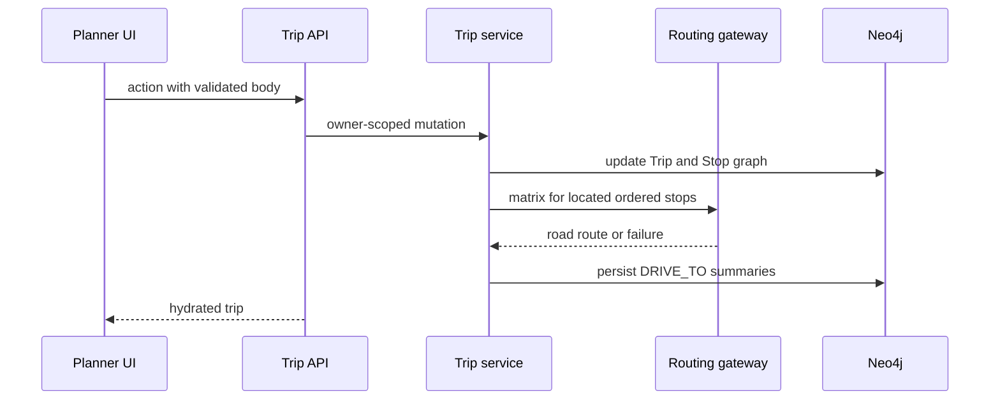

# Trip planner, routing, sharing, and exports

`app/plan/page.tsx` gates the workspace on session identity and mounts `components/plan/PlanShell.tsx`. `PlanShell` keeps builder, map canvas and chat mounted; mobile selects panes using `?pane=` without losing MapLibre/chat state. `TripBuilderProvider` (`useTripBuilder.tsx`) is the client state for trips, metrics, alerts/cost/conditions and day map; `lib/trips.ts` is the server authority.

## Ownership and Stop lifecycle

A trip is `(User)-[:PLANNED]->(Trip {id,userId})`. Every personal read/write matches **both** ID and `userId`, including exports, share and fork. `createTrip()` defaults origin from durable home and defaults `returnToOrigin` only when an origin exists. `addStop()` validates its Park/Campground/ThingToDo/Place, creates a reified `Stop` with append order and one typed relationship (`OF_PARK`, `OF_CAMPGROUND`, `OF_POI`, or `OF_PLACE`), optionally records a considered park, then recomputes routing. Removal renumbers; reorder clears days. Incomplete legacy stops are filtered from hydrated display.

`RoutingGateway` uses ORS matrix/geocoding. Failure falls back to Haversine plus 45mph, marked `great_circle`; only successful ORS legs are cached as rounded-coordinate `DriveLeg` nodes. Stop-to-stop `DRIVE_TO` edges are separate from origin/return properties on Trip. Unlocated stops preserve itinerary order but get no leg; GPX trip connectors are expressly straight lines, not road geometry.

## API contract and planning rules

`/api/trips` GET/POST lists/creates; creation validates ordinary input or a tour seed. `/api/trips/[id]` derives session identity before GET/DELETE/POST, returns 401 without it, 404 for a non-owned/missing trip, 400 for malformed/invalid action input, and 429 when its per-user bucket is exhausted. GET hydrates (`include=metrics` optional), DELETE removes, and POST validates `TripActionSchema` for rename/dates/day plan/origin/stops/reorder/trail/camp inclusion/optimization/fork and alerts/cost/conditions/suggestDays/diff. Mutations are 30 user/minute; reads 60. `lib/validation.ts` bounds bodies and strips unknown properties. It returns a fresh trip after mutation; live metrics enrichment is deliberately caught/non-fatal so a routing/metric-adjacent failure does not discard the successful owned mutation.

Tour seeding materializes ordered valid tour targets and deletes an empty partial Trip if it cannot finish. Cost aggregates structured entrance fees by vehicle/person/motorcycle and can apply annual-pass break-even; alerts read active park alerts and conditions combine graph facts with live providers. These reads are user-scoped via the trip even though their source facts are shared.

`lib/itinerary.ts` packs ordered stops by drive plus visit time (480 minute default, 180 minute visit); the first is day one and an oversized stop remains assigned. Hikes are `Stop-[:INCLUDES_TRAIL]->Trail`; day warnings include hike time and flag above eight hours. Lodging is one nested `STAYS_AT` per Stop, replacing prior lodging. Unknown availability is eligible; known zero availability is fallback-only. Nearest-neighbor optimization leaves unlocated stops in relative order at the end.

## Sharing and exports

Share links are owner-created/revoked `ShareLink` capabilities: UUID without dashes, read-only, 30-day expiry, public resolution with IP 60/minute. `/trips/shared/[token]` is never an edit surface. ICS escapes/folds RFC-style all-day fields with exclusive `DTEND`; GPX labels its connector approximation and may include Blob hike tracks; offline ZIP contains brief/JSON/POIs/boundaries; field brief derives graph details. API paths live below `/api/trips/[id]/ics|gpx|brief|offline|share`.

Test narrow logic with `trips.test.ts`, `routing.test.ts`, `route-order.test.ts`, `itinerary.test.ts`, `share.test.ts`, `ics.test.ts`, `trip-ics.test.ts`, `trip-gpx.test.ts`, `trip-lab.test.ts`. For graph ownership/exports use guarded `trips.itest.ts`, `trip-lab.itest.ts`, `share.itest.ts`, `export.itest.ts`. Change an action across its Zod schema, route operation, service, client action and focused test; never relax owner predicate for convenience.